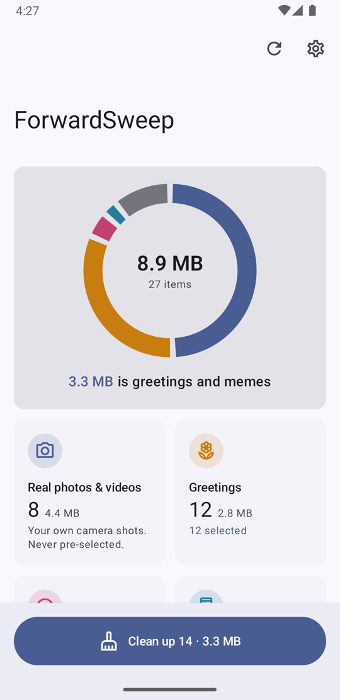
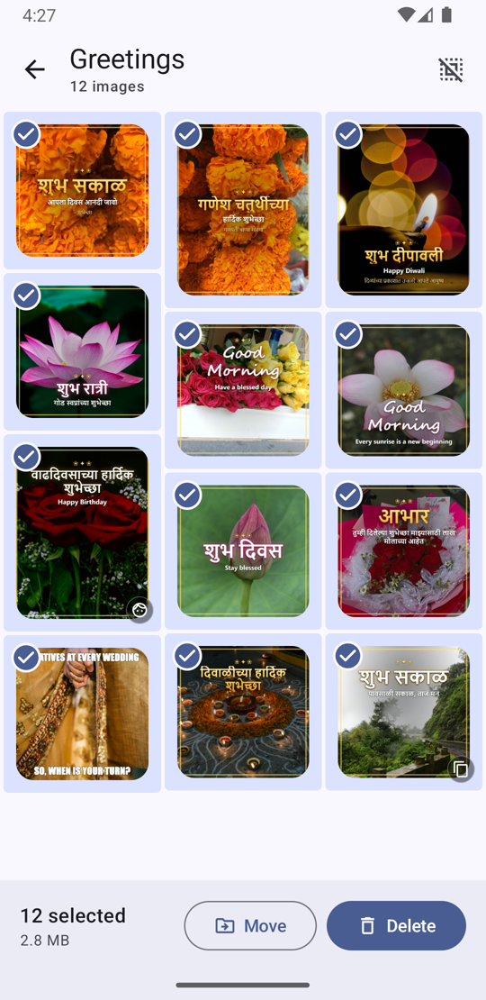
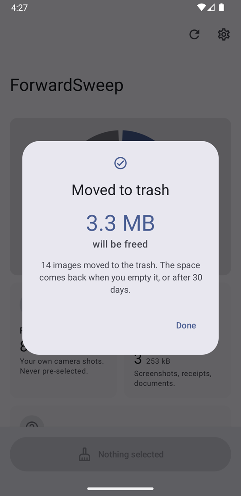

# ForwardSweep

**Sweep the forwards. Keep the memories.**

ForwardSweep is an Android app that finds the WhatsApp forwards piling up on your phone (Good
Morning greetings, festival wishes, memes, forwarded videos and GIFs) and lets you clear them
in one tap, while leaving your own photos and videos alone. Everything runs on the phone: the
app has no internet permission at all.

<p>
  
  
  
</p>

## What it does

* Sorts WhatsApp (and WhatsApp Business) images, videos and GIFs into **Real photos & videos**,
  **Greetings**, **Memes**, **Screenshots & documents** and **Uncertain**. Optionally covers the
  whole gallery.
* Reads Marathi, Hindi and English text in images (शुभ सकाळ, सुप्रभात, Good Morning…).
* Pre-selects only greetings and memes. You review the grid, long-press and drag to change a
  range, and clean up with one system dialog.
* Deletes to the system **trash** (recoverable for 30 days) where Android supports it.
* **Learns from you.** Move an image to another category and similar images are re-sorted
  straight away; deleted greetings and memes count as confirmations.
* Scans incrementally in the background, finishes large libraries while charging, and can
  remind you monthly when greetings pile up.

## Privacy and safety

* **Nothing leaves the phone.** All recognition runs on-device, and the `INTERNET` permission is
  removed from the merged manifest, so this is enforced, not just promised.
* **No `MANAGE_EXTERNAL_STORAGE`.** Only MediaStore with `READ_MEDIA_IMAGES` /
  `READ_MEDIA_VIDEO`.
* **Safety rules come before accuracy:** a junk label needs high confidence and a low real-photo
  probability; strong camera EXIF blocks junk labels; images with faces that might be real
  photos are protected and never pre-selected; images without readable text are never called
  greetings; your own select/deselect choices survive app restarts.
* Android 11+ always asks for system confirmation before anything is trashed or deleted.

## How it works

Each image (or three frames of a video) goes through a pipeline of optional signals, combined
by a scorer into per-category probabilities and then checked by safety rules:

| Signal | Implementation |
|---|---|
| Image understanding (zero-shot) | CLIP image encoder (Meta PE-Core-T) via ONNX Runtime, with 46 text prompts embedded at build time |
| Text in the image (Latin + Devanagari) | ML Kit Text Recognition, keyword and pattern analysis (greetings, memes, documents, event posters) |
| Camera evidence | EXIF make/model/exposure; file names; phone-screen aspect ratios |
| Pixel traits | saturation, flat fills, borders, sensor noise |
| Faces | ML Kit Face Detection (protection only) |
| Duplicates | 64-bit DCT perceptual hash |
| Your corrections | exact-copy memory, CLIP look-alikes, and a small personal model trained on the phone |

See [ARCHITECTURE.md](ARCHITECTURE.md) for the full design.

## Build

Requirements: Android Studio (or JDK 17 + Android SDK 34).

```bash
./gradlew :app:assembleDebug
adb install -r app/build/outputs/apk/debug/app-debug.apk
./gradlew :core:classifier:test        # classifier unit tests (pure Kotlin, no device)
```

The debug APK is large because ML Kit and ONNX Runtime ship native code for every CPU type. Use
an App Bundle for distribution (`./gradlew :app:bundleRelease`).

## The model

The app bundles `app/src/main/assets/models/clip_image.onnx`: the image tower of
[Meta Perception Encoder PE-Core-T-16-384](https://huggingface.co/facebook/PE-Core-T16-384)
(Apache-2.0, 32 MB, fp32), plus `clip_prompts.tsv` with the text prompts embedded once, so
there's no tokenizer on the device. To change prompts or the model:

```bash
pip install torch open_clip_torch onnx onnxruntime
python eval/export_clip.py --out app/src/main/assets/models/
```

Notes from choosing it:

* **Apple MobileCLIP / MobileCLIP2 scored slightly higher but can't be used.** Their weights
  are licensed for research only, which excludes shipping them in an app.
* **Don't int8-quantize these models with dynamic quantization.** Accuracy collapses. Quantizing
  only MatMul layers keeps accuracy but saves little.

## Evaluate and tune on your own images

`tools/harness` runs the same classifier on a folder of images on your computer and writes an
HTML report with the reasons behind every decision.

```bash
./gradlew :tools:harness:installDist
python eval/generate_samples.py                      # synthetic labelled smoke-test set
tools/harness/build/install/forwardsweep/bin/forwardsweep eval eval/sample-set \
    --clip app/src/main/assets/models/clip_image.onnx app/src/main/assets/models/clip_prompts.tsv
```

`eval` expects subfolders `real/ greeting/ meme/ screenshot/` and prints a confusion matrix,
precision/recall per category, and a safety check that exits with code 2 if more than 0.5% of
real photos are labelled junk (usable as a CI gate). `classify <dir>` works on any folder.
The synthetic set is only a smoke test. For real tuning, label a few hundred of your own images.
All weights and thresholds live in `ClassifierConfig`.

## Known limitations

* **WhatsApp "Sent" and "Private" folders are invisible.** WhatsApp marks them `.nomedia`, and
  reading them would need all-files access, which this app doesn't use.
* **Trash frees space later:** after 30 days or when the trash is emptied. Settings can switch
  to permanent deletion.
* **Event posters and ads** have no category of their own yet; they mostly land in
  Screenshot/Document, and some festive ones in Greetings.
* **Phones throttle long scans when warm.** The scan saves every 10 items and runs as a
  foreground service while the app is open, so it resumes cleanly.
* **Text recognition uses Google ML Kit,** which is free to use but not open source. That keeps
  the app out of F-Droid's main repository; replacing it with Tesseract is a welcome
  contribution.
* **Android 10** asks once per item owned by another app (a platform limitation).

## Permissions

| Permission | Why |
|---|---|
| `READ_MEDIA_IMAGES`, `READ_MEDIA_VIDEO` (Android 13+) | Read images and videos through MediaStore |
| `READ_MEDIA_VISUAL_USER_SELECTED` (Android 14+) | Handle "Select photos" partial access |
| `READ_EXTERNAL_STORAGE` (Android 8–12) | Read media on older Android |
| `WRITE_EXTERNAL_STORAGE` (Android 8–9) | Delete on Android 8–9 |
| `FOREGROUND_SERVICE`, `FOREGROUND_SERVICE_DATA_SYNC` | Keep long scans running with a progress notification |
| `POST_NOTIFICATIONS` (Android 13+) | Optional monthly reminder, asked for only when you turn it on |

## Project layout

```
core/classifier/   pure Kotlin: signals, Scorer, PersonalModel, pHash, OnnxClipEngine (+ unit tests)
core/ml/           Android adapters: image/video decoding, ML Kit OCR and faces, model loading
core/data/         Room cache, MediaStore queries, scan workers, deletion, settings
app/               Jetpack Compose UI (Home, Review, Preview, Settings)
tools/harness/     desktop CLI: classify / evaluate a folder, HTML report
eval/              synthetic test-set generator, CLIP export script
marketing/ad/      the promo video and the scripts that build it
```

## Contributing

Issues and pull requests are welcome, especially: an open-source OCR engine (Tesseract) to
replace ML Kit, a Poster/Ad category, and more Indian-language greeting keywords. Please keep the
safety rules intact: a real photo labelled as junk is a bug.

## Licence

ForwardSweep is free software under the **GNU General Public License v3.0**; see
[LICENSE](LICENSE). Third-party components (the PE-Core model, ML Kit, ONNX Runtime, AndroidX,
Coil, and the photos used in the promo video) keep their own licences; see
[THIRD_PARTY_NOTICES.md](THIRD_PARTY_NOTICES.md).

WhatsApp is a trademark of WhatsApp LLC. ForwardSweep is an independent project, not affiliated
with or endorsed by WhatsApp or Meta.
